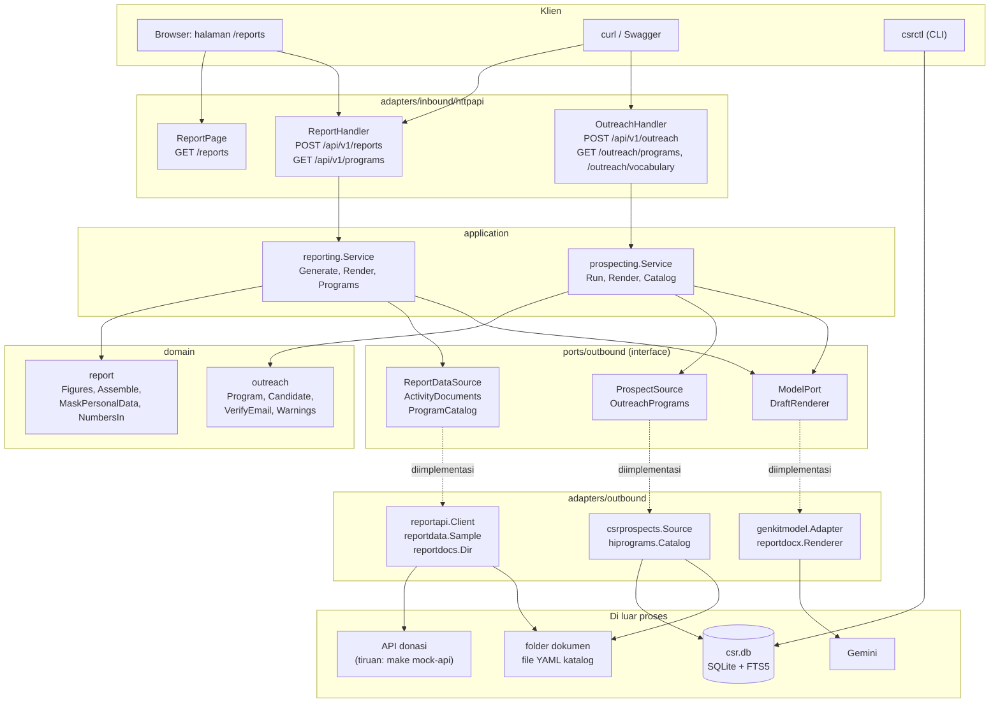
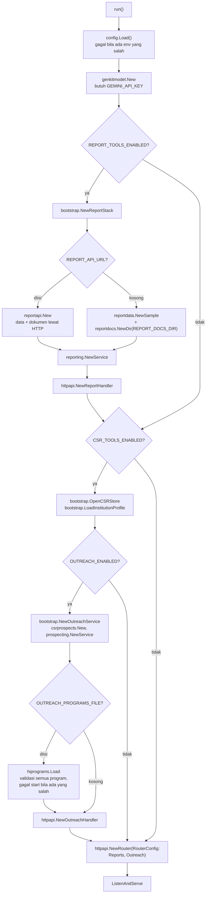

# Panduan engineer: dua pilot agentic AI

Panduan ini untuk engineer yang baru masuk ke repo dan ingin benar-benar
paham dua pilot: **dari perintah yang dijalankan sampai fungsi Go yang
dipanggil**. Setiap diagram memakai nama fungsi yang ada di kode, dan setiap
langkah punya tabel yang menunjuk file dan test-nya.

| Dokumen | Isi |
|---|---|
| **halaman ini** | Peta arsitektur, aturan dependensi, cara menjalankan, semua perintah, konfigurasi, jalur baca kode |
| [praktik.md](praktik.md) | **Mulai dari sini bila ingin mencoba**: tutorial langkah demi langkah dengan `make demo` (tanpa kunci Gemini), hasil yang diharapkan, dan uji pemahaman |
| [pilot-1-laporan-donasi.md](pilot-1-laporan-donasi.md) | Alur lengkap laporan donasi, diagram, fungsi per langkah, debugging |
| [pilot-2-shortlist-pendana.md](pilot-2-shortlist-pendana.md) | Pengisian indeks CSR, alur shortlist dan email, skor, debugging |

Dokumen referensi yang sudah ada dan tidak diulang di sini:
[donation-data-api.md](../donation-data-api.md) (kontrak API donasi),
[donation-report-template.md](../donation-report-template.md) (isi laporan),
[outreach.md](../outreach.md) (aturan shortlist),
[internal/websearch/csr/README.md](../../internal/websearch/csr/README.md)
(pipeline crawl).

- [Dua pilot dalam satu tabel](#dua-pilot-dalam-satu-tabel)
- [Peta arsitektur](#peta-arsitektur)
- [Aturan dependensi](#aturan-dependensi)
- [Peta paket](#peta-paket)
- [Apa yang terjadi saat harness menyala](#apa-yang-terjadi-saat-harness-menyala)
- [Menjalankan semuanya](#menjalankan-semuanya)
- [Semua perintah](#semua-perintah)
- [Konfigurasi](#konfigurasi)
- [Urutan membaca kode](#urutan-membaca-kode)
- [Mau mengubah sesuatu, buka di mana?](#mau-mengubah-sesuatu-buka-di-mana)
- [Test](#test)
- [Log dan debugging](#log-dan-debugging)
- [Glosarium](#glosarium)

## Dua pilot dalam satu tabel

| | Pilot 1: laporan donasi | Pilot 2: shortlist pendana |
|---|---|---|
| Tujuan | Draf laporan program untuk donor | Daftar perusahaan yang mungkin mendanai satu program HI, plus draf email pendekatan |
| Masukan | program + periode | satu program HI (kriteria bidang, wilayah, jenis dukungan) |
| Sumber fakta | API donasi (angka) dan dokumen kegiatan (narasi) | indeks CSR di SQLite (hasil crawl, dengan bukti dan tanggal) |
| Yang ditulis model | dua bagian narasi | satu email per perusahaan |
| Yang ditulis kode | semua angka, tabel, total, saldo | peringkat, alasan, catatan, bukti |
| Endpoint | `POST /api/v1/reports`, halaman `/reports` | `POST /api/v1/outreach` |
| Flag | `REPORT_TOOLS_ENABLED` | `OUTREACH_ENABLED` (butuh `CSR_TOOLS_ENABLED`) |
| Keluaran | JSON (Markdown) atau `.docx` | JSON atau `.docx` |
| Paket inti | `domain/report`, `application/reporting` | `domain/outreach`, `application/prospecting` |
| Terbukti dengan | model palsu, API donasi tiruan | model palsu, indeks SQLite di memori |

Aturan yang sama di kedua pilot, dan yang membentuk hampir semua kode:

> **Fakta datang dari data, bukan dari model.** Model hanya menyusun kalimat,
> dan setiap klaim harus menunjuk sumber. Apa pun yang tidak bisa dipastikan
> kode menjadi **catatan untuk reviewer**, bukan dianggap benar. Hasilnya
> selalu draf: orang yang membaca dan mengirim.

## Peta arsitektur

Arsitektur heksagonal: bagian tengah (domain dan application) tidak tahu HTTP,
Gemini, atau SQLite. Semuanya masuk lewat interface di `ports/`.



Garis putus-putus berarti "diimplementasi oleh". Panah dari application ke
`ports` adalah satu-satunya cara application bicara dengan dunia luar.

## Aturan dependensi

```
domain  <-  application  ->  ports  <-  adapters  <-  cmd (main.go merangkai semuanya)
```

| Paket | Boleh meng-import | Tidak boleh meng-import |
|---|---|---|
| `domain/*` | stdlib, sesama `domain` | adapter, HTTP, Genkit, database |
| `application/*` | `domain`, `ports/outbound`, `platform/caller` | adapter, driver database, Genkit |
| `ports/outbound` | `domain` | adapter |
| `adapters/*` | `domain`, `ports`, library teknis | `application` (kecuali handler HTTP yang memanggil use case) |
| `cmd/*`, `internal/bootstrap` | semuanya | |

Akibat praktisnya: **setiap use case bisa diuji tanpa Gemini, tanpa jaringan,
dan tanpa SQLite**, dengan mengganti port memakai fake di file test. Itu
sebabnya test di `service_test.go` cepat dan deterministik.

Satu hal yang perlu diketahui: indeks CSR (`internal/websearch/csr`) adalah
library mandiri yang tidak meng-import apa pun dari harness. Hanya adapter
`csrprospects`, tool chat CSR, `bootstrap`, dan `cmd/csrctl` yang memakainya;
`application/*` tidak pernah menyentuhnya langsung.

## Peta paket

| Lokasi | Peran |
|---|---|
| `cmd/harness/main.go` | Titik masuk layanan HTTP; `run()` merangkai semua komponen |
| `cmd/csrctl/` | CLI indeks CSR: `import`, `crawl`, `shortlist`, dst. (`shortlist.go` untuk pilot 2) |
| `cmd/mockdonationapi/` | Server API donasi tiruan (`make mock-api`) |
| `internal/bootstrap/` | Perakitan: `NewReportStack`, `NewOutreachService`, `OpenCSRStore` |
| `internal/platform/config/` | Satu-satunya pembaca environment; semua default ada di sini |
| `internal/domain/report/` | Tipe laporan, `Assemble`, pemeriksaan angka, masking |
| `internal/domain/outreach/` | Tipe shortlist, `VerifyEmail`, `Warnings`, tata letak dokumen |
| `internal/application/reporting/` | Use case pilot 1 (`Generate`) |
| `internal/application/prospecting/` | Use case pilot 2 (`Run`) |
| `internal/ports/outbound/` | Semua interface keluar |
| `internal/adapters/inbound/httpapi/` | Router, handler, DTO, halaman `/reports` |
| `internal/adapters/outbound/reportapi/` | Client HTTP ke API donasi |
| `internal/adapters/outbound/reportdata/` | Angka contoh (`Sample`) bila tidak ada API |
| `internal/adapters/outbound/reportdocs/` | Dokumen dari folder |
| `internal/adapters/outbound/doctext/` | Teks dari `.pdf`, `.docx`, `.txt`, `.md` |
| `internal/adapters/outbound/reportdocx/` | Penulis `.docx` |
| `internal/adapters/outbound/csrprospects/` | Menilai indeks CSR terhadap satu program |
| `internal/adapters/outbound/hiprograms/` | Katalog program HI dari YAML |
| `internal/adapters/outbound/genkitmodel/` | `ModelPort` lewat Genkit dan Gemini |
| `internal/mockapi/` | Isi API donasi tiruan dan datanya |
| `cmd/pilotdemo/` | Demo satu proses: API tiruan + indeks karangan + model palsu (`make demo`) |
| `internal/websearch/csr/` | Indeks CSR: crawl, ekstraksi, skor, query |

## Apa yang terjadi saat harness menyala

`cmd/harness/main.go` → `run()` membaca konfigurasi, membuat model, lalu
mendaftarkan fitur sesuai flag. Tidak ada fitur yang menyala tanpa flag-nya.



`NewRouter` hanya memasang route bila handler-nya tidak `nil`
(`RouterConfig.Reports`, `RouterConfig.Outreach`). Jadi fitur yang dimatikan
menjawab **404 `not_found`**, bukan 403.

Pemeriksaan konfigurasi yang membuat harness menolak start
(`internal/platform/config/config.go`):

| Kondisi | Pesan |
|---|---|
| `OUTREACH_ENABLED=true` tanpa `CSR_TOOLS_ENABLED=true` | shortlist membaca indeks CSR |
| `REPORT_API_URL` diisi tanpa `REPORT_TOOLS_ENABLED=true` | fitur laporan mati |
| `REPORT_API_URL` bukan URL http(s) | |
| `REPORT_API_TIMEOUT_SECONDS` >= `REQUEST_TIMEOUT_SECONDS` | harus lebih pendek |
| `OUTREACH_PROGRAMS_FILE` diisi tanpa `OUTREACH_ENABLED=true` | |
| Isi `OUTREACH_PROGRAMS_FILE` salah (id, duplikat, tanpa bidang fokus) | gagal saat start, menyebut programnya |

## Menjalankan semuanya

Ada dua tingkat. Yang pertama **tidak butuh kunci Gemini** dan cukup untuk
memahami hampir semua kode.

### Tingkat 0: demo satu perintah (disarankan untuk mulai)

```bash
make demo        # API donasi tiruan + indeks CSR karangan + model palsu, semuanya satu proses
```

Menjalankan **kedua pilot dengan kode yang sama dengan produksi**, hanya model
dan sumber datanya yang palsu (semua tulisan model berawalan `[DEMO]`). Tutorial
berurutan ada di [praktik.md](praktik.md). `make demo QUIRK=fake-email` (atau
`invent-number`, `bad-json-once`) membuat model palsu berulah sekali, supaya
pemeriksaan dan percobaan ulang terlihat bekerja. Kodenya di `cmd/pilotdemo/`.

### Tingkat 1: tanpa kunci Gemini

```bash
make setup                 # sekali saja: git hooks + swag
make ci                    # vet, gofmt, test -race, cek swagger, build

# Lihat satu test jalan dengan detail
go test ./internal/application/reporting/ -run TestGenerate_HappyPath -v
go test ./internal/application/prospecting/ -run TestRun_DraftsAnEmailPerCompany -v

# API donasi tiruan: data dan dokumen, bisa dicoba dengan curl
make mock-api                                      # terminal 1, port 8090
curl -s "localhost:8090/v1/programs"
curl -s "localhost:8090/v1/programs/pangan-jakarta/report-data?from=2026-01-01&to=2026-03-31"
curl -s "localhost:8090/v1/programs/pangan-jakarta/documents"

# Shortlist dari indeks, tanpa model (butuh indeks yang sudah terisi)
go run ./cmd/csrctl shortlist -program config/program.example.yaml
```

Untuk indeks CSR yang terisi tanpa Gemini, `crawl -discover-only` mencari
halaman CSR tetapi tidak mengekstrak profil (ekstraksi butuh model). Tanpa
profil, `shortlist` kosong. Lihat
[pilot 2](pilot-2-shortlist-pendana.md#bagian-a-bagaimana-indeks-terisi).

### Tingkat 2: dengan kunci Gemini

```bash
export GEMINI_API_KEY=...                          # https://aistudio.google.com/apikey
export API_KEYS=$(openssl rand -hex 32)            # kunci klien, minimal 32 karakter
export HTTP_ADDR=127.0.0.1:8080

# Terminal 1: API donasi tiruan
make mock-api

# Terminal 2: harness dengan kedua pilot
export REPORT_TOOLS_ENABLED=true REPORT_API_URL=http://127.0.0.1:8090
export CSR_TOOLS_ENABLED=true OUTREACH_ENABLED=true
export OUTREACH_PROGRAMS_FILE=config/hi-programs.example.yaml
make run

# Terminal 3
open http://127.0.0.1:8080/reports                 # halaman pilot 1 (masukkan $API_KEYS)

curl -s -X POST localhost:8080/api/v1/reports -H "X-API-Key: $API_KEYS" \
  -d '{"program_id":"pangan-jakarta","from":"2026-01-01","to":"2026-03-31"}'

curl -s -X POST localhost:8080/api/v1/outreach -H "X-API-Key: $API_KEYS" \
  -d '{"program_id":"beasiswa-anak-desa","emails":false}'
```

`/api/v1/outreach` hanya mengembalikan perusahaan bila indeks CSR sudah
terisi. Tanpa itu jawabannya 422 `no_prospects` dengan alasan yang jelas.

## Semua perintah

### Build, test, kualitas

| Perintah | Fungsi |
|---|---|
| `make setup` | Pasang git hooks dan `swag` (sekali) |
| `make ci` | Persis yang dijalankan CI: `lint`, `test-race`, `swagger-check`, `build` |
| `make test` / `make test-race` | Semua test, dengan atau tanpa race detector |
| `make cover` | Cakupan per paket |
| `make swagger` | Regenerasi `api/swagger` dari anotasi `@` di handler |
| `make build` | Binary statis ke `bin/harness` |
| `make run` | Jalankan harness (`go run ./cmd/harness`) dengan env saat ini |
| `make mock-api` | API donasi tiruan di `127.0.0.1:8090` |
| `make demo` | Kedua pilot dengan data karangan dan model palsu, tanpa kunci ([praktik.md](praktik.md)) |

### csrctl (indeks CSR)

Membaca env yang sama dengan harness (`CSR_DB_PATH`, `WEB_*`, `GEMINI_API_KEY`).
Output ke stdout, log ke stderr.

| Perintah | Fungsi | Fungsi Go |
|---|---|---|
| `csrctl import config/csr-seed.example.csv` | Masukkan perusahaan awal (CSV atau JSON) | `cmdImport` → `csr.ImportSeed` |
| `csrctl crawl [-discover-only] [-company NAMA]` | Crawl perusahaan yang jatuh tempo | `cmdCrawl` → `Crawler.RunOnce` / `CrawlCompany` |
| `csrctl schedule [-at 02:00] [-tz Asia/Jakarta]` | Crawl harian terus-menerus | `cmdSchedule` |
| `csrctl discover` | Cari perusahaan baru lewat pencarian terbuka | `cmdDiscover` → `Discoverer.RunOnce` |
| `csrctl candidates [-min-hosts 3]` | Perusahaan temuan yang pantas masuk daftar | `cmdCandidates` → `Store.PromotionCandidates` |
| `csrctl companies [-status new] [-limit 50]` | Daftar perusahaan | `cmdCompanies` |
| `csrctl show NAMA` | Rute, profil, bukti satu perusahaan | `cmdShow` |
| `csrctl set-status ID new\|verified\|excluded` | Keputusan manusia atas satu perusahaan | `cmdSetStatus` |
| `csrctl route pin\|reject\|restore ...` | Koreksi rute halaman CSR | `cmdRoute` |
| `csrctl shortlist -program FILE [-limit N] [-csv]` | Peringkat untuk satu program, **tanpa model** | `cmdShortlist` → `csrprospects.Source.Prospects` |

### Endpoint

| Endpoint | Pilot | Fungsi handler |
|---|---|---|
| `POST /api/v1/reports` | 1 | `ReportHandler.ServeHTTP` |
| `GET /api/v1/programs` | 1 | `ReportHandler.Programs` |
| `GET /reports`, `/reports/app.js`, `/reports/app.css` | 1 | `ReportPage` |
| `POST /api/v1/outreach` | 2 | `OutreachHandler.ServeHTTP` |
| `GET /api/v1/outreach/programs` | 2 | `OutreachHandler.Catalog` |
| `GET /api/v1/outreach/vocabulary` | 2 | `OutreachHandler.Vocabulary` |
| `/swagger/*` | | hanya bila `SWAGGER_ENABLED=true` |

Semua `/api/v1/*` butuh header `X-API-Key`. Halaman `/reports` sendiri publik
(statis), tetapi setiap panggilan yang dibuatnya butuh kunci.

## Konfigurasi

Semua default ada di `internal/platform/config/config.go`; contoh di
[`.env.example`](../../.env.example). Yang relevan untuk pilot:

| Variabel | Default | Pilot | Arti |
|---|---|---|---|
| `GEMINI_API_KEY` | wajib | 1, 2 | Kunci model |
| `API_KEYS` | wajib | 1, 2 | Kunci klien, min. 32 karakter |
| `REQUEST_TIMEOUT_SECONDS` | 60 | 1, 2 | Batas satu request, termasuk panggilan model |
| `REPORT_TOOLS_ENABLED` | false | 1 | Menyalakan laporan dan tool `get_report_figures` |
| `REPORT_API_URL` | kosong | 1 | API donasi. Kosong: angka contoh + folder dokumen |
| `REPORT_API_KEY` | kosong | 1 | Dikirim sebagai `X-API-Key` ke API donasi (rahasia) |
| `REPORT_API_TIMEOUT_SECONDS` | 15 | 1 | Batas satu panggilan ke API donasi |
| `REPORT_DOCS_DIR` | `data/report-docs` | 1 | Folder dokumen bila `REPORT_API_URL` kosong |
| `CSR_TOOLS_ENABLED` | false | 2 | Membuka indeks CSR |
| `CSR_DB_PATH` | `data/csr.db` | 2 | Berkas SQLite indeks |
| `CSR_INSTITUTION_PROFILE` | `config/institution-profile.yaml` | 2 | Profil lembaga (ambang keyakinan; skor chat tool) |
| `CSR_STALE_AFTER_DAYS` | 120 | 2 | Berapa lama data dianggap masih terkini |
| `OUTREACH_ENABLED` | false | 2 | Menyalakan `/api/v1/outreach` |
| `OUTREACH_PROGRAMS_FILE` | kosong | 2 | Katalog program HI (YAML) |
| `MODEL_INPUT_RUPIAH_PER_MILLION_TOKENS` | 0 | 2 | Harga token masuk untuk perkiraan biaya |
| `MODEL_OUTPUT_RUPIAH_PER_MILLION_TOKENS` | 0 | 2 | Harga token keluar |
| `HTTP_ADDR` | `:8080` | | Alamat dengar harness |
| `LOG_FORMAT` | `json` | | `text` lebih enak dibaca saat belajar |

## Urutan membaca kode

Disusun dari yang paling menjelaskan ke yang paling detail. Dua jam pertama
cukup untuk satu pilot.

1. [`internal/ports/outbound/report_data.go`](../../internal/ports/outbound/report_data.go) dan [`prospects.go`](../../internal/ports/outbound/prospects.go) — daftar semua "pintu" use case. Pendek.
2. Pilot 1: [`application/reporting/service.go`](../../internal/application/reporting/service.go), fungsi `Generate`. Ini jantungnya; sisanya dipanggil dari sini.
3. [`domain/report/draft.go`](../../internal/domain/report/draft.go), fungsi `Assemble`: bagaimana angka dan narasi menjadi satu dokumen.
4. [`domain/report/document.go`](../../internal/domain/report/document.go): masking dan pemeriksaan angka.
5. Pilot 2: [`application/prospecting/service.go`](../../internal/application/prospecting/service.go), fungsi `Run`, lalu [`email.go`](../../internal/application/prospecting/email.go), fungsi `draftEmail`.
6. [`domain/outreach/verify.go`](../../internal/domain/outreach/verify.go): pemeriksaan email.
7. [`adapters/outbound/csrprospects/source.go`](../../internal/adapters/outbound/csrprospects/source.go) lalu [`websearch/csr/score.go`](../../internal/websearch/csr/score.go): dari mana skor datang.
8. [`adapters/inbound/httpapi/report_handler.go`](../../internal/adapters/inbound/httpapi/report_handler.go) dan `outreach_handler.go`: bagaimana error use case menjadi kode HTTP.
9. [`cmd/harness/main.go`](../../cmd/harness/main.go) dan [`internal/bootstrap/`](../../internal/bootstrap/): perakitan.
10. Test (lihat [Test](#test)): cara tercepat memahami perilaku yang diharapkan.

## Mau mengubah sesuatu, buka di mana?

| Perubahan | Ubah | Jangan lupa |
|---|---|---|
| Susunan atau judul bagian laporan | `domain/report/draft.go` (`Assemble`, `sectionTitles`) | `docs/donation-report-template.md`, `report_test.go` |
| Menambah bagian narasi | `report.NarrativeSections`, `narrative.go` (prompt dan `parseNarratives`) | Test `TestAssemble*`, `parseNarratives` |
| Bahasa atau nada narasi | konstanta `systemPrompt` di `reporting/narrative.go` | Coba dengan model asli |
| Format keluaran baru (misalnya PDF) | Adapter baru yang mengimplementasikan `outbound.DraftRenderer`, daftarkan di `bootstrap.NewReportStack` dan `NewOutreachService` | `Format()`, `ContentType()`, `Extension()` |
| Sumber data donasi lain | Adapter baru untuk `ReportDataSource` dan `ActivityDocuments` | Ganti di `bootstrap/report.go` |
| Format dokumen baru (misalnya `.xlsx`) | `doctext.Supported` dan `Extractor.Text` | Test di `reportdocs` dan `reportapi` |
| Aturan masking data pribadi | `report.MaskPersonalData` (regex di `document.go`) | `TestMaskPersonalData` |
| Pemeriksaan angka | `report.NumbersIn`, `UnsupportedNumbers`, `Figures.KnownNumbers` | Tanggal juga angka: lihat catatan di `outreach.VerifyEmail` |
| Bobot skor perusahaan | `websearch/csr/score.go` (`Score`, `scorePrograms`) | `score_test.go`, hitung ulang angka di test |
| Kelompok bidang dan sinonim | `focusGroups` di `score.go` | `TestFocusGroups`, `TestCoverage` |
| Prompt email | konstanta `systemPrompt` di `prospecting/email.go` | Pemeriksaan di `VerifyEmail` harus tetap konsisten dengan aturan prompt |
| Aturan penolakan email | `outreach.VerifyEmail` | `TestVerifyEmail_*` |
| Catatan untuk reviewer | `prospecting.candidateNotes`, `outreach.Warnings` | `render.go` bila tampilannya ikut berubah |
| Kode error HTTP | `writeReportError`, `OutreachHandler.writeError`, `writeCommonError` | Anotasi `@Failure` lalu `make swagger` |
| Kolom respons API | DTO di `httpapi/dto.go`, `toOutreachResponse` | `make swagger` |
| Batas ukuran, jumlah percobaan | `reporting.DefaultConfig`, `prospecting.DefaultConfig` | |

## Test

Setiap lapisan punya test sendiri. Cara tercepat memahami perilaku: baca
nama test, lalu jalankan satu dengan `-v`.

| Yang diuji | Lokasi | Contoh |
|---|---|---|
| Aturan domain (total, masking, angka, `Assemble`) | `internal/domain/report/report_test.go` | `TestAssemble`, `TestMaskPersonalData` |
| Aturan domain pilot 2 | `internal/domain/outreach/outreach_test.go` | `TestVerifyEmail_Problems`, `TestWarnings` |
| Use case pilot 1 (model palsu) | `internal/application/reporting/service_test.go` | `TestGenerate_RetriesAndTellsTheModelWhy` |
| Use case pilot 2 (model palsu, konkuren) | `internal/application/prospecting/service_test.go` | `TestRun_ACompanyWithoutAnAcceptableEmailKeepsItsPlace` |
| Adapter indeks CSR (SQLite asli di memori) | `internal/adapters/outbound/csrprospects/source_test.go` | `TestProspects_ScoresAgainstTheProgram` |
| Client API donasi vs. mock | `internal/adapters/outbound/reportapi/client_test.go` | `TestFigures_AgainstTheMockAPI` |
| Penulis `.docx`, pembaca dokumen | `reportdocx/`, `reportdocs/`, `doctext` | `TestRender_Content` |
| Handler HTTP | `internal/adapters/inbound/httpapi/report_handler_test.go`, `outreach_handler_test.go` | `TestOutreach_EndToEndWithARealIndex` |
| Konfigurasi | `internal/platform/config/config_test.go` | `TestLoad_ReportAPI` |
| Skor, cakupan istilah | `internal/websearch/csr/score_test.go` | `TestCoverage` |
| CLI | `cmd/csrctl/shortlist_test.go` | `TestShortlistCommand_CSVRatingSheet` |

Satu test end-to-end per pilot menjalankan rantai penuh dengan hanya model
yang palsu: `TestReports_EndToEndOverHTTPWithTheMockAPI` (pilot 1, lewat
HTTP sungguhan ke API tiruan) dan `TestOutreach_EndToEndWithARealIndex`
(pilot 2, dari indeks SQLite sampai respons HTTP).

```bash
go test ./...                                     # cepat
go test -race ./internal/application/...          # periksa kode konkuren (pilot 2 memanggil model paralel)
go test ./internal/application/prospecting/ -run TestRun -v
```

## Log dan debugging

Gunakan `LOG_FORMAT=text` saat belajar. Baris yang penting:

| Baris log | Dari | Isi |
|---|---|---|
| `report drafted` | `reporting.Service.Generate` | `key_id`, program, periode, dokumen dibaca dan dikutip, jumlah catatan, token |
| `narrative rejected` | `writeNarratives` | percobaan ke berapa dan alasan penolakan |
| `shortlist built` | `prospecting.Service.Run` | `key_id`, program, jumlah, email berhasil, token, durasi |
| `email rejected` | `draftEmail` | perusahaan, percobaan, alasan |
| `activity document unreadable` | `reportdocs.Dir.List`, `reportapi.Client.List` | berkas yang gagal dibaca |
| `http request` | middleware | status, durasi, `request_id` |

Teks laporan, teks dokumen, dan teks email **tidak pernah** masuk log; hanya
metadata. `request_id` ada di setiap respons error dan di setiap baris log
untuk request itu, jadi satu request bisa ditelusuri dari awal sampai akhir.

Gejala yang sering muncul:

| Gejala | Kemungkinan penyebab | Periksa |
|---|---|---|
| 404 `not_found` di `/api/v1/reports` | `REPORT_TOOLS_ENABLED` belum `true` | log start: "report endpoint enabled" |
| 404 `not_found` di `/api/v1/outreach` | `OUTREACH_ENABLED` belum `true` | log start: "outreach endpoint enabled" |
| 500 `internal_error` di laporan | API donasi mati atau menolak kunci, atau kunci Gemini salah | log `report failed` (error aslinya ada di sana) |
| 422 `no_documents` | program tak punya dokumen terbaca (PDF tanpa `pdftotext`, PDF hasil scan) | log `activity document unreadable`; catatan di draf |
| 422 `no_prospects` | indeks kosong, atau istilah tidak cocok | pesan error memuat alasannya |
| 502 `narrative_failed` | model dua kali memberi jawaban yang ditolak | log `narrative rejected` |
| 503 `model_unavailable` | Gemini sibuk | header `Retry-After` |

## Glosarium

| Istilah | Arti |
|---|---|
| Port | Interface Go di `ports/outbound` yang dipakai use case untuk bicara ke luar |
| Adapter | Implementasi port (HTTP, SQLite, Gemini, folder) |
| Use case | Satu alur bisnis di `application/` (`Generate`, `Run`) |
| Draf (`report.Draft`) | Dokumen terstruktur (blok judul, paragraf, tabel, daftar) yang bisa dirender ke Markdown atau `.docx` |
| Catatan reviewer (`Notes`) | Hal yang tidak bisa dipastikan kode dan harus diperiksa manusia |
| Bukti (`Evidence`) | Kutipan persis dari halaman perusahaan, sudah diverifikasi muncul di halaman itu |
| Indeks CSR | Basis data SQLite hasil crawl: perusahaan, halaman, profil, program, bukti |
| Rute (routing record) | Daftar halaman CSR yang diketahui untuk satu perusahaan |
| Basi (`Stale`) | Datanya tidak dikonfirmasi halaman mana pun dalam `CSR_STALE_AFTER_DAYS` hari |
| `FocusMatch` | Setidaknya satu bidang fokus program cocok dengan bidang perusahaan; syarat masuk shortlist |
| Cakupan istilah (`TermCoverage`) | Berapa perusahaan di indeks yang cocok dengan satu istilah kriteria program |
| Penanggung Jawab | Product owner di sisi HI yang menilai hasil |
