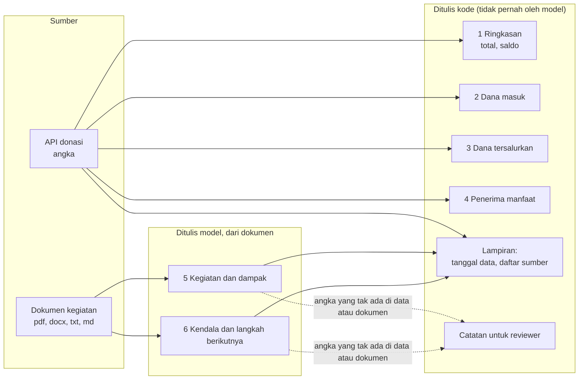
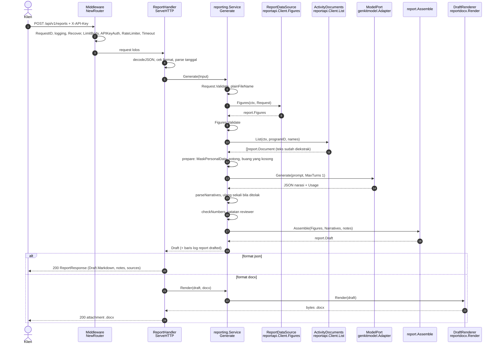
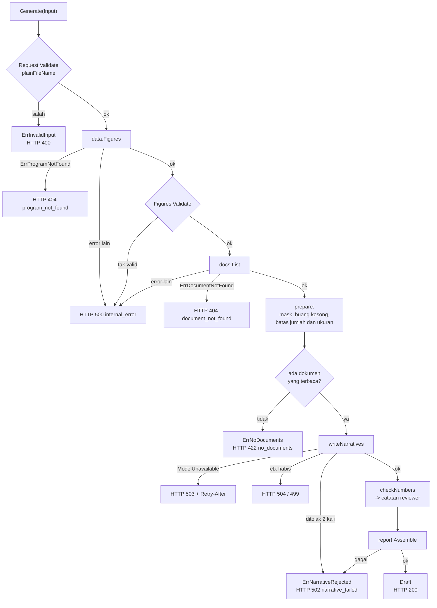
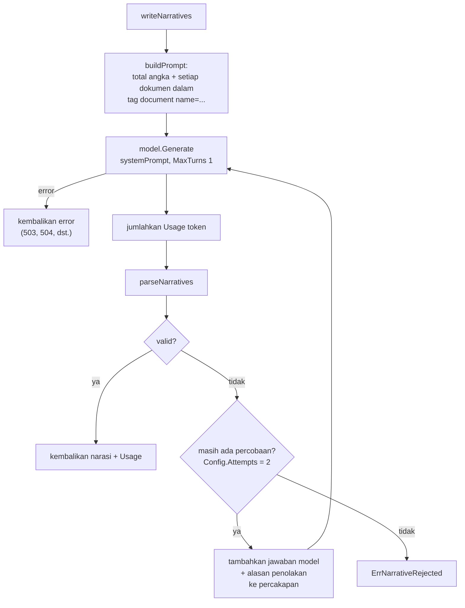
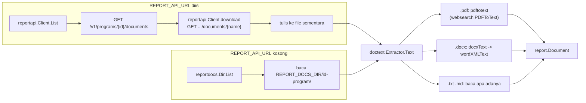
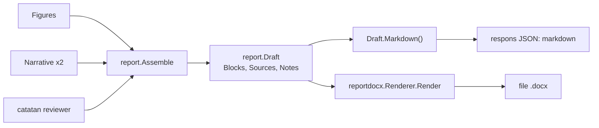
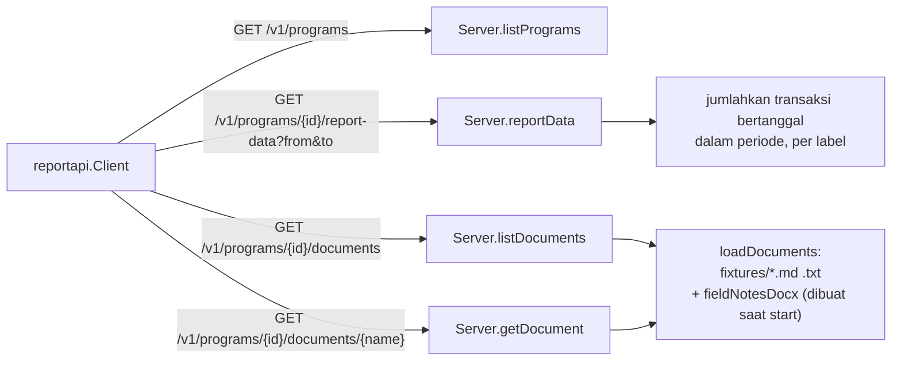
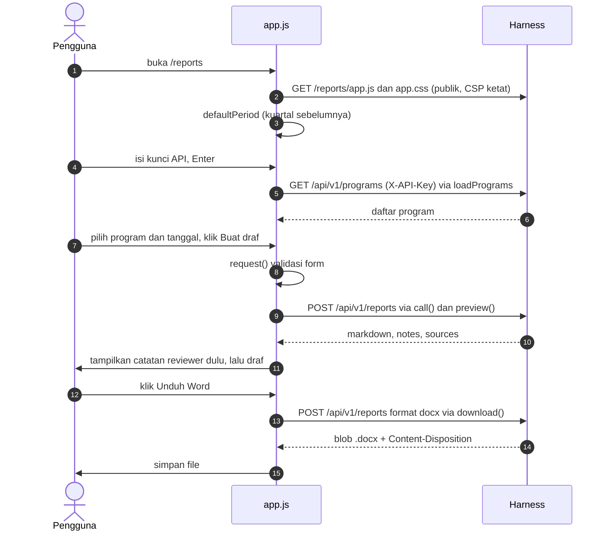

# Pilot 1: laporan donasi

Dari "program + periode" menjadi draf laporan untuk donor: **angka dari data
donasi, narasi dari dokumen kegiatan**. Halaman ini menjelaskan alurnya
langkah demi langkah, dengan fungsi Go yang menjalankan tiap langkah.

Ingin langsung mencoba? Ikuti [praktik.md](praktik.md) (tanpa kunci Gemini).
Baca [README panduan](README.md) dulu untuk peta arsitektur, aturan
dependensi, dan cara menjalankan. Spesifikasi isi laporan ada di
[donation-report-template.md](../donation-report-template.md), kontrak API
donasi di [donation-data-api.md](../donation-data-api.md).

- [Gambaran satu kalimat](#gambaran-satu-kalimat)
- [Perintah untuk mencoba](#perintah-untuk-mencoba)
- [Siapa menulis apa](#siapa-menulis-apa)
- [Alur satu request](#alur-satu-request)
- [Langkah demi langkah: fungsi dan file](#langkah-demi-langkah-fungsi-dan-file)
- [Dari error ke kode HTTP](#dari-error-ke-kode-http)
- [Bagian dalam: menulis narasi](#bagian-dalam-menulis-narasi)
- [Bagian dalam: dari dokumen ke teks](#bagian-dalam-dari-dokumen-ke-teks)
- [Bagian dalam: menyusun draf dan merender](#bagian-dalam-menyusun-draf-dan-merender)
- [API donasi tiruan](#api-donasi-tiruan)
- [Halaman /reports](#halaman-reports)
- [Tool chat get_report_figures](#tool-chat-get_report_figures)
- [Mengikuti satu request dari log](#mengikuti-satu-request-dari-log)
- [Latihan: ubah sesuatu](#latihan-ubah-sesuatu)

## Gambaran satu kalimat

`POST /api/v1/reports` → `ReportHandler.ServeHTTP` → `reporting.Service.Generate`
mengambil angka dan dokumen lewat port, meminta model menulis dua bagian
narasi dari dokumen itu, memeriksa hasilnya, lalu `report.Assemble` menyatukan
angka (dari kode) dan narasi (dari model) menjadi `report.Draft` yang bisa
dilihat sebagai Markdown atau diunduh sebagai `.docx`.

## Perintah untuk mencoba

```bash
make mock-api                                   # terminal 1: API donasi tiruan di :8090

export GEMINI_API_KEY=... API_KEYS=$(openssl rand -hex 32)
REPORT_TOOLS_ENABLED=true REPORT_API_URL=http://127.0.0.1:8090 \
  LOG_FORMAT=text make run                      # terminal 2: harness di :8080

# JSON: Markdown + catatan reviewer + sumber
curl -s -X POST localhost:8080/api/v1/reports -H "X-API-Key: $API_KEYS" \
  -d '{"program_id":"pangan-jakarta","from":"2026-01-01","to":"2026-03-31"}'

# Word
curl -s -X POST localhost:8080/api/v1/reports -H "X-API-Key: $API_KEYS" \
  -d '{"program_id":"pangan-jakarta","from":"2026-01-01","to":"2026-03-31","format":"docx"}' \
  -o laporan.docx

# Hanya dokumen tertentu
curl -s -X POST localhost:8080/api/v1/reports -H "X-API-Key: $API_KEYS" \
  -d '{"program_id":"pangan-jakarta","from":"2026-01-01","to":"2026-03-31","documents":["laporan-kegiatan-q1-2026.md"]}'

# Halaman untuk tim program
open http://127.0.0.1:8080/reports
```

Tanpa `REPORT_API_URL`, harness memakai angka contoh (`sample-program`) dan
membaca dokumen dari `REPORT_DOCS_DIR/<id program>/`.

Tanpa kunci Gemini, lihat alurnya lewat test:
`go test ./internal/application/reporting/ -run TestGenerate -v`.

## Siapa menulis apa

Ini keputusan desain yang paling penting di pilot 1. Semua kode lain ada
untuk menjaganya.



Total dan saldo **dihitung dari baris tabel** (`Figures.TotalReceived`,
`TotalDisbursed`, `Balance`, `TotalBeneficiaries` di
`internal/domain/report/report.go`), bukan dikirim oleh API. Jadi total tidak
mungkin berbeda dari tabelnya.

## Alur satu request



Hal yang perlu dicatat dari diagram ini:

- Langkah 2 berjalan untuk setiap `/api/v1/*`. Urutan middleware ada di
  komentar `NewRouter` ([router.go](../../internal/adapters/inbound/httpapi/router.go)).
- Format yang salah ditolak di langkah 4, **sebelum** ada panggilan ke API
  donasi atau model, supaya request yang pasti gagal tidak memakan biaya.
- Hanya langkah 13 yang memanggil model, dan hanya sekali (dua kali bila
  jawaban pertama ditolak).
- Langkah 12 (`prepare`) menjalankan masking **sebelum** teks dokumen
  sampai ke model.

## Langkah demi langkah: fungsi dan file

| # | Langkah | Fungsi | File | Test |
|---|---|---|---|---|
| 1 | Baca body JSON, tolak field tak dikenal | `decodeJSON` | `httpapi/shared.go` | `TestReports_ClientErrors` |
| 2 | Cek format, parse `from` dan `to` | `ReportHandler.ServeHTTP` | `httpapi/report_handler.go` | `TestReports_ClientErrors` |
| 3 | Validasi program, periode, nama dokumen | `report.Request.Validate`, `plainFileName` | `domain/report/report.go`, `application/reporting/service.go` | `TestGenerate_Errors` |
| 4 | Ambil angka | `ReportDataSource.Figures` → `reportapi.Client.Figures` (atau `reportdata.Sample.Figures`) | `adapters/outbound/reportapi/client.go` | `TestFigures_AgainstTheMockAPI`, `TestFigures_DistrustsTheAPI` |
| 5 | Periksa angka dari sumber | `report.Figures.Validate` | `domain/report/report.go` | `TestFiguresValidate` |
| 6 | Ambil dokumen dan teksnya | `ActivityDocuments.List` → `reportapi.Client.List` (atau `reportdocs.Dir.List`) | `reportapi/client.go`, `reportdocs/docs.go` | `TestList_AgainstTheMockAPI` |
| 7 | Masking, potong, buang dokumen kosong | `Service.prepare`, `report.MaskPersonalData` | `application/reporting/service.go`, `domain/report/document.go` | `TestGenerate_KeepsContactDetailsAndInjectionAwayFromTheModel`, `TestGenerate_CutsLongDocumentsAndSaysSo` |
| 8 | Minta model menulis narasi | `Service.writeNarratives`, `buildPrompt` | `application/reporting/narrative.go` | `TestGenerate_HappyPath` |
| 9 | Baca dan periksa jawaban model | `parseNarratives`, `jsonObject` | `narrative.go` | `TestGenerate_RejectsIncompleteAnswers`, `TestGenerate_AcceptsFencedJSON` |
| 10 | Ulangi bila ditolak | loop di `writeNarratives` (`Config.Attempts`) | `narrative.go` | `TestGenerate_RetriesAndTellsTheModelWhy` |
| 11 | Tandai angka yang tak punya sumber | `checkNumbers`, `report.NumbersIn`, `report.UnsupportedNumbers`, `Figures.KnownNumbers` | `service.go`, `domain/report/document.go` | `TestGenerate_FlagsNumbersNobodyStated` |
| 12 | Susun dokumen | `report.Assemble` | `domain/report/draft.go` | `TestAssemble`, `TestAssembleRefusesIncompleteNarratives` |
| 13 | Catat audit | `s.log.InfoContext(... "report drafted" ...)` | `service.go` | `TestGenerate_WritesAnAuditLine` |
| 14a | Keluarkan sebagai Markdown | `Draft.Markdown` | `domain/report/markdown.go` | `TestAssemble` |
| 14b | Atau render `.docx` | `Service.Render` → `reportdocx.Renderer.Render` | `application/reporting/service.go`, `reportdocx/docx.go` | `TestRender`, `TestRender_ProducesWellFormedParts` |
| 15 | Petakan error ke HTTP | `ReportHandler.writeReportError`, `writeCommonError` | `httpapi/report_handler.go`, `shared.go` | `TestReports_DocumentProblems`, `TestReports_ModelProblems` |

Alur `Generate` sebagai diagram keputusan, dengan setiap titik gagal dan kode
HTTP-nya:



## Dari error ke kode HTTP

Use case mengembalikan error bertipe (sentinel), dan **hanya handler** yang
tahu kode HTTP. Dengan begitu `reporting.Service` bisa dipakai dari CLI atau
antrean tanpa membawa HTTP.

| Error use case | HTTP | `code` | Dibuat di |
|---|---|---|---|
| `ErrInvalidInput`, `ErrUnknownFormat` | 400 | `invalid_request` | `Generate`, `Render` |
| `outbound.ErrProgramNotFound` | 404 | `program_not_found` | adapter data |
| `outbound.ErrDocumentNotFound` | 404 | `document_not_found` | adapter dokumen |
| `ErrNoDocuments` | 422 | `no_documents` | `Generate` |
| `context.Canceled` (klien pergi) | 499 | `client_closed_request` | `writeCommonError` |
| `context.DeadlineExceeded` | 504 | `timeout` | `writeCommonError` |
| `outbound.ModelUnavailableError` | 503 | `model_unavailable` | `genkitmodel.classifyError` |
| `ErrNarrativeRejected` | 502 | `narrative_failed` | `writeNarratives`, `Assemble` |
| lainnya | 500 | `internal_error` | |

`writeCommonError` dipakai bersama oleh chat, laporan, dan shortlist.

## Bagian dalam: menulis narasi

`writeNarratives` ([narrative.go](../../internal/application/reporting/narrative.go))
adalah satu-satunya tempat model dipanggil di pilot 1.



`parseNarratives` menolak jawaban bila: tidak ada objek JSON, JSON tidak
berbentuk `{activities:{text,sources}, challenges:{...}}`, bagian hilang,
teks kosong, tidak mengutip sumber, atau mengutip nama file yang **tidak
diberikan** ke model. Alasannya dikirim balik ke model pada percobaan kedua.

Pertahanan terhadap isi dokumen yang berbahaya:

| Ancaman | Penanganan | Di mana |
|---|---|---|
| Dokumen berisi perintah ("abaikan aturan...") | Teks dokumen dikirim sebagai data di dalam `<document>`; prompt sistem menyebutnya data, bukan perintah | `systemPrompt`, `buildPrompt` |
| Dokumen menutup tag-nya sendiri | `</document` diganti `< /document` | `buildPrompt` |
| Kontak pribadi bocor ke model | `MaskPersonalData` mengganti email, nomor HP, NIK 16 digit | `prepare` |
| Model mengarang angka | `checkNumbers` menandai angka yang tak ada di data atau dokumen yang dikutip | `service.go` |
| Model mengutip dokumen yang tak ada | `parseNarratives` menolak | `narrative.go` |

Catatan jujur: **nama orang tidak dimasking** (tidak bisa dikenali andal
dengan regex). Itu ada di TODO.

## Bagian dalam: dari dokumen ke teks

Dua jalur menuju `report.Document{Name, Text}`; keduanya memakai
`doctext.Extractor.Text` supaya sebuah berkas dibaca dengan cara yang sama di
mana pun asalnya.



Pembatas dan perilaku yang sengaja:

- `reportapi.Client` tidak pernah mengikuti redirect (kunci API ikut terbawa
  ke host lain), membatasi ukuran respons, dan menolak nama dokumen berisi `/`.
- Satu dokumen yang rusak **tidak** menggagalkan laporan: ia tetap ada di
  daftar dengan teks kosong, lalu `prepare` membuangnya dan menulis catatan
  untuk reviewer.
- PDF butuh `pdftotext` (paket `poppler-utils`). Tanpanya PDF dilewati dengan
  catatan. PDF hasil scan tidak punya teks dan juga dilewati.
- `.docx` dibaca langsung dari XML-nya (`word/document.xml`), dengan batas
  30 MB setelah dibuka supaya arsip berbahaya tidak membengkak.

## Bagian dalam: menyusun draf dan merender

`report.Assemble` ([draft.go](../../internal/domain/report/draft.go)) tidak
menulis file. Ia menghasilkan `report.Draft`: daftar `Block` bertipe
`BlockHeading`, `BlockParagraph`, `BlockTable`, `BlockBullets`. Renderer yang
mengubahnya menjadi format:



`Assemble` menolak membuat draf bila: angka tidak valid, bagian narasi hilang
atau kosong atau tidak punya sumber, atau ada bagian yang tidak dikenal.
Tujuannya: **draf yang tidak lengkap tidak pernah terlihat lengkap**.

`reportdocx` menulis `.docx` langsung dengan `archive/zip`: lima bagian XML
(`[Content_Types].xml`, `_rels/.rels`, `word/_rels/document.xml.rels`,
`word/styles.xml`, `word/document.xml`). Tidak ada dependensi dokumen.
Karakter kontrol yang tidak boleh ada di XML dibuang di `escape`.

Untuk menambah format baru, buat tipe yang mengimplementasikan
`outbound.DraftRenderer` (`Format`, `ContentType`, `Extension`, `Render`) dan
daftarkan di `bootstrap.NewReportStack`. Tidak ada kode lain yang berubah.

## API donasi tiruan

Karena API donasi asli belum ada, `make mock-api` menyajikan kontrak yang
sama dengan data karangan. Ini juga contoh bagaimana API asli harus
berperilaku.



- Kode: [`internal/mockapi/mockapi.go`](../../internal/mockapi/mockapi.go);
  data di `internal/mockapi/fixtures/` (`programs.json`, `documents/<id>/`).
- `Server.reportData` menjumlahkan transaksi per label untuk tanggal yang
  masuk periode, jadi periode berbeda memberi total berbeda.
- Dokumen Q1 `pangan-jakarta` memuat angka yang sama dengan data Q1
  (1.320 keluarga, 2.030 anak), sehingga narasi yang benar lolos
  `checkNumbers` tanpa catatan.
- Dokumen itu juga memuat nama, email, dan nomor HP koordinator, untuk
  memperlihatkan masking.
- Mengganti ke API asli = mengisi `REPORT_API_URL` dan `REPORT_API_KEY`.
  Bila kontraknya beda, ubah hanya `reportapi/client.go`.

## Halaman /reports

Halaman statis untuk tim program: kunci API, pilih program dan periode,
lihat draf atau unduh Word. Kode di
`internal/adapters/inbound/httpapi/reportpage/` (`index.html`, `app.js`,
`app.css`), disajikan oleh `ReportPage` (`report_page.go`, lewat `go:embed`).



Aturan yang dijaga halaman ini (dites di `TestReportPage` dan lewat Chrome
headless saat dibuat):

- Tidak ada skrip atau gaya inline, jadi CSP `script-src 'self'` cukup.
- Teks dari server hanya ditampilkan lewat `textContent`, tidak pernah
  sebagai HTML.
- Kunci API disimpan di `sessionStorage`, hanya selama tab terbuka.
- Pesan error pengguna ada di tabel `ERRORS` di `app.js`, dipetakan dari
  `code` respons.

## Tool chat get_report_figures

Selain endpoint, angka laporan juga tersedia sebagai tool untuk agen chat
(`POST /api/v1/chat`), di balik flag yang sama:
`tools.ReportFiguresTool.Execute` ([report.go](../../internal/adapters/outbound/tools/report.go)).
Tool ini memanggil `ReportDataSource.Figures` yang sama dan mengembalikan
JSON berisi angka, total, dan saldo. Deskripsinya memerintahkan model agar
**semua angka laporan berasal dari tool ini**, tidak dihitung atau diingat
sendiri. Didaftarkan di `cmd/harness/main.go` dalam blok `REPORT_TOOLS_ENABLED`.

## Mengikuti satu request dari log

Jalankan dengan `LOG_FORMAT=text`. Satu laporan yang berhasil menulis
(urutannya sama dengan diagram):

```text
level=INFO msg="report drafted" key_id=a1b2c3d4e5f6 program=pangan-jakarta
  from=2026-01-01 to=2026-03-31
  documents_read="[catatan-lapangan-maret-2026.docx evaluasi-triwulan-ii-2026.txt laporan-kegiatan-q1-2026.md]"
  documents_cited="[laporan-kegiatan-q1-2026.md catatan-lapangan-maret-2026.docx]"
  review_notes=0 input_tokens=2310 output_tokens=215
level=INFO msg="http request" method=POST path=/api/v1/reports status=200 duration_ms=4120 request_id=...
```

`review_notes` > 0 berarti ada sesuatu yang harus diperiksa manusia
(lihat `notes` di respons). `narrative rejected` muncul bila model memberi
jawaban yang ditolak (dengan `reason`). Nilai di atas hanya contoh bentuk.

## Latihan: ubah sesuatu

Cara terbaik memahami kode adalah mengubahnya dan melihat test mana yang
gagal.

1. **Ubah judul bagian 5** di `sectionTitles` (`domain/report/draft.go`). Test
   mana yang gagal? Dokumen mana yang harus ikut diubah?
2. **Turunkan `MaxCharsPerDocument`** di `reporting.DefaultConfig` menjadi 100.
   Jalankan `TestGenerate_CutsLongDocumentsAndSaysSo`, lalu cari catatan reviewer
   di keluaran.
3. **Tambahkan pola masking** untuk nomor rekening di `document.go`. Mulai
   dengan menulis test di `report_test.go`.
4. **Buat renderer teks polos**: tipe baru yang mengimplementasikan
   `DraftRenderer` dengan `Draft.Markdown()`, daftarkan di `NewReportStack`,
   lalu panggil dengan `"format":"txt"`.
5. **Matikan API donasi tiruan** saat harness berjalan dan lihat apa yang
   dikembalikan. Di mana error aslinya muncul? (Petunjuk: `report failed` di log.)
