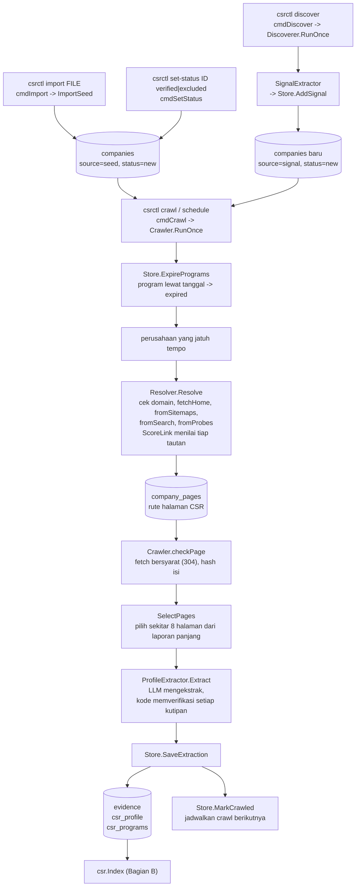
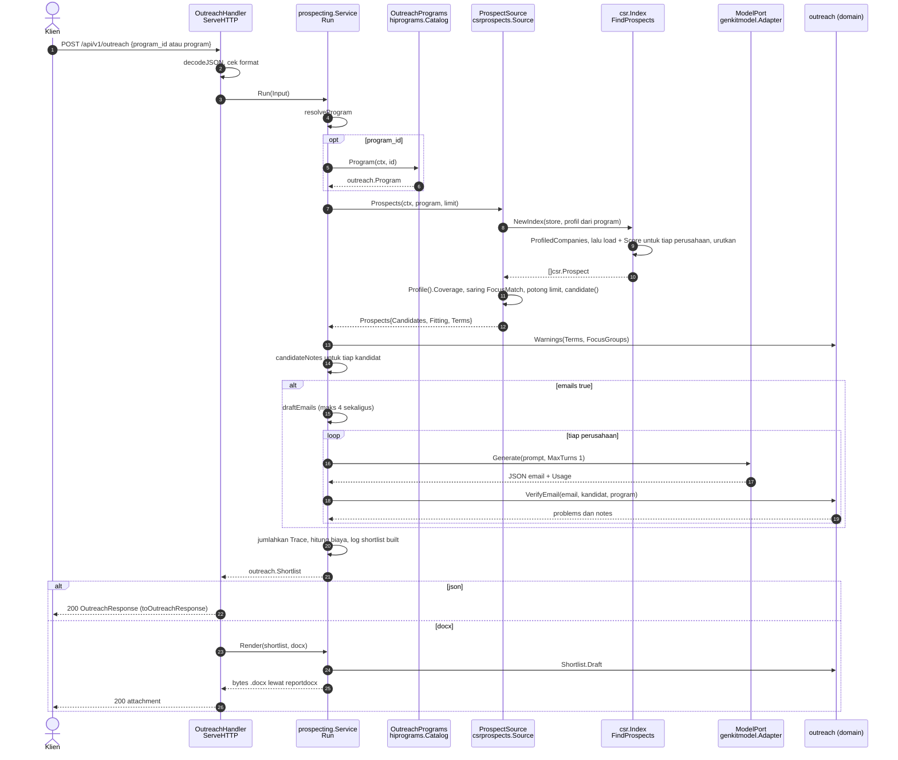
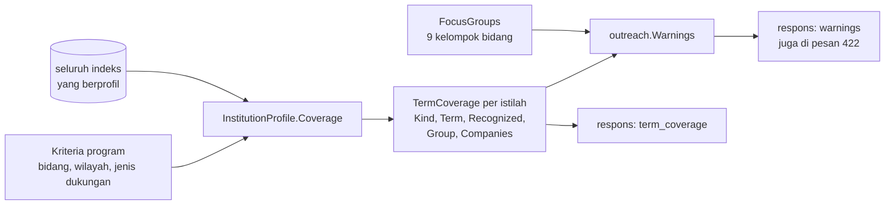
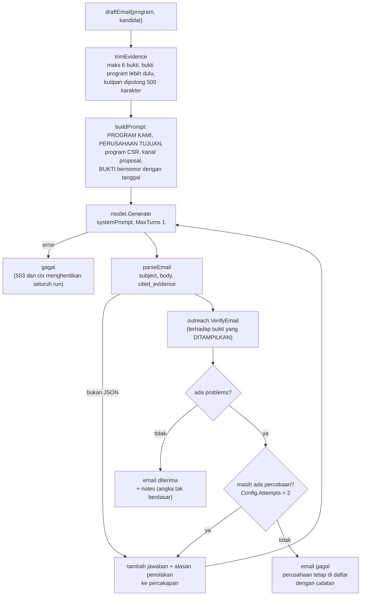
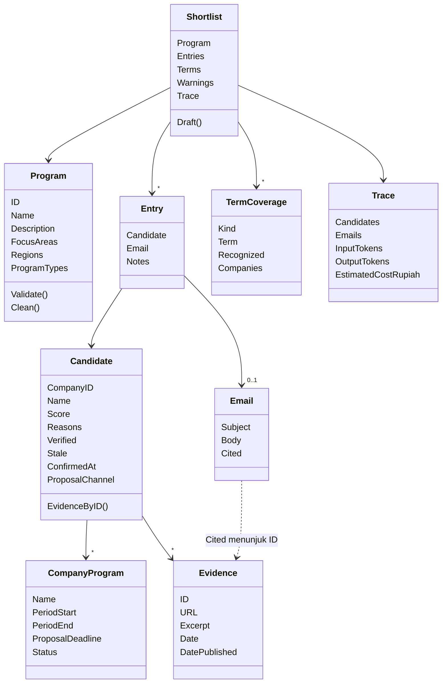

# Pilot 2: shortlist pendana dan email pendekatan

Dari satu program Human Initiative menjadi **daftar perusahaan yang mungkin
mendanainya**, dengan alasan, bukti, dan draf email untuk tiap perusahaan.
Halaman ini menjelaskan dua hal yang saling bergantung: bagaimana **indeks CSR
terisi** (Bagian A), dan bagaimana **shortlist dibuat dari indeks itu**
(Bagian B), dengan fungsi Go yang menjalankan tiap langkah.

Ingin langsung mencoba? Ikuti [praktik.md](praktik.md) (tanpa kunci Gemini).
Baca [README panduan](README.md) dulu untuk peta arsitektur dan aturan
dependensi. Aturan produk ada di [outreach.md](../outreach.md); detail crawl di
[internal/websearch/csr/README.md](../../internal/websearch/csr/README.md).

- [Gambaran satu kalimat](#gambaran-satu-kalimat)
- [Perintah untuk mencoba](#perintah-untuk-mencoba)
- [Bagian A: bagaimana indeks terisi](#bagian-a-bagaimana-indeks-terisi)
- [Bagian B: dari program ke shortlist](#bagian-b-dari-program-ke-shortlist)
- [Langkah demi langkah: fungsi dan file](#langkah-demi-langkah-fungsi-dan-file)
- [Dari mana skor datang](#dari-mana-skor-datang)
- [Cakupan istilah dan peringatan](#cakupan-istilah-dan-peringatan)
- [Bagian dalam: satu email](#bagian-dalam-satu-email)
- [Catatan untuk reviewer](#catatan-untuk-reviewer)
- [Model data](#model-data)
- [Dari error ke kode HTTP](#dari-error-ke-kode-http)
- [Biaya dan jejak](#biaya-dan-jejak)
- [Mengukur relevansi](#mengukur-relevansi)
- [Latihan: ubah sesuatu](#latihan-ubah-sesuatu)
- [Batasan yang perlu diketahui](#batasan-yang-perlu-diketahui)

## Gambaran satu kalimat

`POST /api/v1/outreach` → `OutreachHandler.ServeHTTP` → `prospecting.Service.Run`
meminta `csrprospects.Source.Prospects` menilai semua perusahaan di indeks
terhadap program itu (memakai skor yang sudah ada di `websearch/csr`), menambah
catatan dari data indeks, lalu meminta model menulis satu email per
perusahaan; setiap email diperiksa terhadap bukti yang dikutipnya sebelum
diterima.

## Perintah untuk mencoba

**Tanpa kunci Gemini** (indeks diisi test, bukan crawl nyata):

```bash
go test ./internal/adapters/outbound/csrprospects/ -run TestProspects -v
go test ./internal/application/prospecting/ -run TestRun -v
go test ./internal/adapters/inbound/httpapi/ -run TestOutreach_EndToEndWithARealIndex -v
go run ./cmd/csrctl shortlist -program config/program.example.yaml   # indeks kosong: menjelaskan mengapa
```

**Dengan indeks nyata** (butuh kunci Gemini, dan SearXNG untuk pencarian):

```bash
export GEMINI_API_KEY=... CSR_DB_PATH=data/csr.db WEB_TOOLS_ENABLED=true SEARXNG_URL=http://127.0.0.1:8888

# 1. isi indeks (Bagian A)
go run ./cmd/csrctl import config/csr-seed.example.csv
go run ./cmd/csrctl crawl -company "PT Contoh Energi Tbk"      # satu perusahaan sekarang
go run ./cmd/csrctl companies                                   # lihat hasilnya
go run ./cmd/csrctl show "Contoh Energi"                        # rute, profil, bukti
go run ./cmd/csrctl set-status 1 verified                       # keputusan manusia

# 2. lihat peringkat tanpa model
go run ./cmd/csrctl shortlist -program config/program.example.yaml
go run ./cmd/csrctl shortlist -program config/program.example.yaml -csv > lembar.csv

# 3. jalankan lewat harness, dengan email
export API_KEYS=$(openssl rand -hex 32)
CSR_TOOLS_ENABLED=true OUTREACH_ENABLED=true \
  OUTREACH_PROGRAMS_FILE=config/hi-programs.example.yaml LOG_FORMAT=text make run

curl -s localhost:8080/api/v1/outreach/programs   -H "X-API-Key: $API_KEYS"
curl -s localhost:8080/api/v1/outreach/vocabulary -H "X-API-Key: $API_KEYS"
curl -s -X POST localhost:8080/api/v1/outreach -H "X-API-Key: $API_KEYS" \
  -d '{"program_id":"beasiswa-anak-desa","limit":5}'
# tanpa model: "emails": false.  Word: "format": "docx" dan -o calon-mitra.docx
curl -s -X POST localhost:8080/api/v1/outreach -H "X-API-Key: $API_KEYS" \
  -d '{"program":{"name":"Beasiswa Anak Desa","focus_areas":["pendidikan"],"regions":["Jawa Barat"]},"emails":false}'
```

---

## Bagian A: bagaimana indeks terisi

Pilot 2 **tidak mencari di web saat ada request**. Ia membaca indeks yang
sudah diisi crawler terjadwal (`csrctl`), yang berjalan di luar harness (cron,
CronJob, atau `csrctl schedule`). Karena itu shortlist cepat dan murah, dan
mutunya persis sebaik indeksnya.



| Tahap | Fungsi | File di `internal/websearch/csr/` | Intinya |
|---|---|---|---|
| Impor | `ReadSeedCSV`, `ReadSeedJSON`, `ImportSeed` | `seed.go` | Gabung nama yang sama (`NormalizeName`), laporkan baris yang bermasalah |
| Temukan perusahaan baru | `Discoverer.RunOnce`, `ExpandQueries` | `discover.go`, `signals.go` | Hasilnya selalu `status=new`; kode otomatis **tidak pernah** menandai `verified` |
| Cari halaman CSR | `Resolver.Resolve` | `resolve.go`, `classify.go`, `sitemap.go` | Menyimpan rute beserta **cara menemukannya** (homepage, sitemap, search, probe, manual) |
| Cek ulang | `Crawler.checkPage` | `crawl.go` | Fetch bersyarat; 304 dihitung sebagai berhasil. Interval: program mingguan, yayasan 2 minggu, berita 3 hari, laporan 90 hari |
| Laporan panjang | `SelectPages` | `pages.go` | Aturan, bukan model; hanya sekitar 8k token yang sampai ke model |
| Ekstraksi | `ProfileExtractor.Extract` | `extract.go` | Setiap kutipan harus muncul **persis** di halamannya; klaim tanpa bukti dibuang; tanggal diperiksa terhadap kutipan yang memuat tahunnya |
| Simpan | `Store.SaveExtraction` | `store.go`, `programs.go` | Bukti, profil, dan program (dengan siklus hidup) disimpan dalam satu transaksi |
| Keputusan manusia | `cmdSetStatus` | `cmd/csrctl/main.go` | `new` → `verified` atau `excluded` |

Siklus hidup program (`csr.Program.Status`): `active` → `expired` (lewat
tanggal akhir atau batas proposal; aturan tanggal, tanpa model) → `stale` (hilang
dari satu pembacaan ulang) → `inactive` (hilang dari dua pembacaan berturut-turut).
Program tidak pernah dihapus, supaya riwayatnya tetap bisa diaudit.

Dua hal yang perlu dipegang:

- **Tanpa profil, perusahaan tidak ada di shortlist.** `Store.ProfiledCompanies`
  hanya mengembalikan perusahaan yang punya baris `csr_profile` dan
  statusnya bukan `excluded`. `crawl -discover-only` (`CrawlOptions.SkipExtraction`)
  mencari rute tetapi tidak membuat profil.
- Ekstraksi memakai model, jadi **mutu indeks bergantung pada Gemini asli**;
  sampai itu dijalankan sungguhan, hasilnya hanya teruji dengan model palsu.

---

## Bagian B: dari program ke shortlist



Hal yang perlu dicatat:

- Indeks **tidak dibatasi** oleh `limit` saat menilai: seluruh perusahaan
  (sampai 1.000) dinilai dulu, baru dipotong. Karena itu `Fitting` dan
  `TermCoverage` menggambarkan seluruh indeks, bukan hanya `limit` teratas.
- `csrprospects.Source.Prospects` **membuat `csr.Index` baru di setiap
  request**, dengan profil dari program yang diminta (bukan profil lembaga di
  `config/institution-profile.yaml`). Itulah yang membuat skor bergantung pada
  program.
- Bila `emails=false`, tidak ada panggilan model sama sekali.

## Langkah demi langkah: fungsi dan file

| # | Langkah | Fungsi | File | Test |
|---|---|---|---|---|
| 1 | Baca body, cek `format` | `decodeJSON`, `OutreachHandler.ServeHTTP` | `httpapi/outreach_handler.go`, `shared.go` | `TestOutreach_ClientErrors` |
| 2 | Pilih program: katalog atau inline | `Service.resolveProgram`, `hiprograms.Catalog.Program`, `Program.Clean`, `Program.Validate` | `application/prospecting/service.go`, `adapters/outbound/hiprograms/file.go`, `domain/outreach/outreach.go` | `TestRun_ProgramFromTheCatalog`, `TestRun_ProgramResolutionErrors` |
| 3 | Nilai indeks terhadap program | `csrprospects.Source.Prospects` → `csr.NewIndex`, `Index.FindProspects` | `adapters/outbound/csrprospects/source.go`, `websearch/csr/query.go` | `TestProspects_ScoresAgainstTheProgram` |
| 4 | Skor tiap perusahaan | `InstitutionProfile.Score`, `scorePrograms`, `freshness` | `websearch/csr/score.go`, `query.go` | `TestScore_StrongMatchIsExplained`, `TestScore_FocusMatchIsSeparateFromTheScore` |
| 5 | Hitung cakupan istilah | `InstitutionProfile.Coverage` | `websearch/csr/score.go` | `TestCoverage` |
| 6 | Saring dan potong | loop di `Source.Prospects` (`FocusMatch`, `limit`) | `csrprospects/source.go` | `TestProspects_LimitCutsAfterRankingButCountsEveryFit` |
| 7 | Petakan ke tipe domain | `csrprospects.candidate` | `csrprospects/source.go` | `TestProspects_ScoresAgainstTheProgram` |
| 8 | Peringatan kriteria | `outreach.Warnings` | `domain/outreach/criteria.go` | `TestWarnings` |
| 9 | Catatan per perusahaan | `candidateNotes` | `application/prospecting/service.go` | `TestRun_NotesFromTheIndex` |
| 10 | Buat email paralel | `Service.draftEmails` | `service.go` | `TestRun_DraftsAnEmailPerCompany` (jalankan dengan `-race`) |
| 11 | Satu email | `Service.draftEmail`, `trimEvidence`, `buildPrompt`, `parseEmail` | `application/prospecting/email.go` | `TestRun_WhatTheModelIsGiven`, `TestRun_RetriesAnInventedContactAndTellsTheModel` |
| 12 | Periksa email | `outreach.VerifyEmail` | `domain/outreach/verify.go` | `TestVerifyEmail_Problems`, `TestVerifyEmail_AcceptsTheDatesItIsAskedToState` |
| 13 | Jejak dan biaya | akhir `Service.Run` | `service.go` | `TestRun_DraftsAnEmailPerCompany`, `TestRun_AuditLineHasNoEmailText` |
| 14 | Respons JSON | `toOutreachResponse` | `httpapi/outreach_handler.go` | `TestOutreach_JSON` |
| 15 | Word | `Service.Render`, `Shortlist.Draft`, `reportdocx.Renderer.Render` | `service.go`, `domain/outreach/render.go` | `TestOutreach_DOCX`, `TestShortlistDraft` |

## Dari mana skor datang

Skor ada di [`websearch/csr/score.go`](../../internal/websearch/csr/score.go)
dan **bisa dijelaskan**: setiap poin datang dengan alasan (dalam bahasa
Indonesia) yang tampil di respons. Tidak ada poin tanpa alasan.

`InstitutionProfile.Score` menilai profil perusahaan terhadap kriteria (di
pilot 2: kriteria **program** yang diminta):

| Komponen | Poin | Syarat |
|---|---|---|
| Bidang fokus cocok | `min(45, 25 + 10 × (jumlah cocok − 1))` | Bidang program sama (lewat kelompok sinonim) dengan bidang atau jenis program perusahaan; ini yang mengisi `FocusMatch` |
| Wilayah | 20 | Halaman perusahaan menyebut wilayah yang diminta |
| | 15 | Halaman menyebut program berskala nasional |
| | 5 | Hanya label wilayah dari data awal (belum terbukti di halaman) |
| Jenis program | 10 | Jenis dukungan program sama dengan jenis program perusahaan |
| Membuka kemitraan | 15 | Halaman menyebut perusahaan menerima proposal atau mencari mitra |
| Kanal proposal | 10 | Ada kontak resmi untuk proposal |
| `scorePrograms` | +10 | Ada program **aktif** yang relevan |
| | −10 | Ada program tercatat tetapi semuanya sudah berakhir |

Skor maksimum 100. `LowConfidence` menyala bila keyakinan ekstraksi di bawah
`min_confidence`.

**Urutan** (`Index.FindProspects`): data terkini sebelum basi → tepercaya
sebelum diragukan → skor tertinggi → keyakinan perusahaan tertinggi.

**Basi** (`freshness` di `query.go`): perusahaan punya profil tetapi semua
halaman CSR-nya hilang atau memblokir akses, atau data terakhir dikonfirmasi
lebih dari `CSR_STALE_AFTER_DAYS` hari lalu. Perusahaan basi tetap tampil,
diberi label, dan diurutkan terakhir.

**Syarat masuk shortlist** ada di adapter, bukan di skor: `Match.FocusMatch`
harus benar. Tanpa itu, perusahaan yang hanya mendapat poin dari wilayah dan
kanal proposal (30 poin) akan masuk padahal bidangnya tidak relevan.

## Cakupan istilah dan peringatan

Pertanyaan umum: "kenapa hasilnya sedikit atau kosong?". Jawabannya ada di
respons, tidak perlu menebak.



- **Dikenali** (`Recognized`): bidang atau jenis dukungan yang termasuk salah
  satu dari 9 kelompok di `focusGroups` (`score.go`). "beasiswa", "sekolah",
  "pendidikan" adalah satu kelompok. Istilah di luarnya (salah ketik,
  "olahraga") hanya cocok dengan perusahaan yang memakai kata yang sama
  persis, dan `Warnings` menyebutnya beserta daftar yang dikenali.
- **Wilayah** berupa teks bebas, jadi selalu dianggap dikenali; yang dihitung
  adalah berapa perusahaan yang menyebutnya (perusahaan berskala nasional
  dihitung ikut).
- `GET /api/v1/outreach/vocabulary` menampilkan daftar kelompok, dari
  `csr.FocusGroups` lewat `Source.FocusGroups` dan `Service.FocusGroups`.

## Bagian dalam: satu email

`draftEmail` ([email.go](../../internal/application/prospecting/email.go))
menyatukan tiga hal: apa yang diberikan ke model, apa yang boleh dijawab, dan
apa yang diperiksa kode.



Dua keputusan desain yang sering ditanyakan:

- **`problems` vs `notes`.** `VerifyEmail` mengembalikan keduanya.
  *Problems* membuat email tidak bisa dipakai, sehingga model diminta mengulang:
  subjek atau isi kosong, lebih dari 3.000 karakter, tidak mengutip bukti,
  mengutip bukti yang tidak diberikan, atau memuat **alamat email atau link
  yang tidak ada di bukti mana pun** (alamat karangan bisa mengirim proposal ke
  orang asing). *Notes* adalah hal yang sebaiknya dilihat manusia pada email
  yang sudah layak: angka yang tidak ada di bukti.
- **Tanggal bukti dihitung sah.** Prompt memerintahkan email menyebut kapan
  informasi itu terbit atau diambil, jadi `VerifyEmail` memasukkan tanggal
  semua bukti dan tanggal konfirmasi data ke korpus angka yang diizinkan.
  Tanpa itu, "per 2026-09-01" ditandai sebagai angka karangan (9 dan 1). Ini
  ditemukan lewat test dan sekarang terkunci di
  `TestVerifyEmail_AcceptsTheDatesItIsAskedToState`.

Konkurensi di `draftEmails`: satu goroutine per perusahaan, dibatasi semaphore
(`Config.Concurrency = 4`). Satu perusahaan gagal tidak menghentikan yang lain.
Hanya error yang membuat **semua** email pasti gagal (`isFatal`: model tidak
tersedia, konteks dibatalkan atau habis) yang membatalkan seluruh run.

## Catatan untuk reviewer

Dua sumber, keduanya muncul di `entries[].notes` dan di dokumen Word:

| Dari | Contoh | Fungsi |
|---|---|---|
| Data indeks | belum diverifikasi, data lama (dengan alasan), keyakinan ekstraksi rendah, kanal proposal tidak diketahui, perusahaan menyebut tidak membuka kemitraan, belum ada program aktif | `candidateNotes` |
| Email | angka di email yang tak ada di bukti, "Draf email gagal dibuat: ..." | `VerifyEmail` (notes), `draftEmails` |
| Kriteria program | istilah tak dikenali, istilah yang tak cocok siapa pun | `outreach.Warnings` → `warnings` |

Aturan di balik semuanya: **yang tidak bisa dipastikan kode menjadi catatan,
bukan dianggap benar.**

## Model data



Semuanya ada di [`domain/outreach/outreach.go`](../../internal/domain/outreach/outreach.go).
`Email.Cited` hanya berisi ID; teks bukti dicari lewat
`Candidate.EvidenceByID`, sehingga sebuah email tidak bisa mengutip sesuatu
yang tidak ada di kandidatnya.

## Dari error ke kode HTTP

| Error use case | HTTP | `code` |
|---|---|---|
| `ErrInvalidInput`, `ErrUnknownFormat` | 400 | `invalid_request` |
| `outbound.ErrProgramNotFound` (id tidak ada di katalog) | 404 | `program_not_found` |
| `ErrNoProspects` (`*NoProspectsError`, membawa peringatan) | 422 | `no_prospects` |
| `ModelUnavailableError` | 503 | `model_unavailable` |
| `context.DeadlineExceeded` | 504 | `timeout` |
| lainnya | 500 | `internal_error` |

Pesan 422 berisi peringatan kriteria, jadi pembuat request langsung tahu
istilah mana yang bermasalah. `NoProspectsError.Is` membuat
`errors.Is(err, ErrNoProspects)` tetap benar walau errornya membawa data.

## Biaya dan jejak

Setiap panggilan model melaporkan token (`ModelPort.Generate` mengembalikan
`GenerateResponse.Usage`; `genkitmodel.Adapter` mengisinya dari respons
penyedia). `draftEmail` menjumlahkannya per email (`EmailTrace`), `Run`
menjumlahkan semuanya (`Trace`) dan, bila harga diisi
(`MODEL_*_RUPIAH_PER_MILLION_TOKENS`), menghitung `EstimatedCostRupiah`.

```text
level=INFO msg="shortlist built" key_id=a1b2c3d4e5f6 program="Beasiswa Anak Desa"
  fitting=14 shortlisted=10 emails_drafted=9 input_tokens=21400 output_tokens=2310 duration_ms=11800
```

Satu email yang gagal tetap tercatat di `trace.emails` dengan `outcome` yang
menjelaskan alasannya, sehingga laju penolakan bisa diukur dari respons
sendiri. Token tepat untuk panggilan tanpa tool (kasus kedua pilot); dengan
tool, hanya putaran terakhir yang terhitung.

## Mengukur relevansi

Target pilot: Penanggung Jawab menilai minimal 70% perusahaan di shortlist
relevan.

```bash
csrctl shortlist -program config/program.example.yaml -csv > lembar.csv
```

`writeRatingSheet` menulis kolom `rank, company_id, company, score,
review_status, data_confirmed, proposal_channel, reasons, programs`, lalu dua
kolom kosong `relevant (y/n)` dan `comment` untuk diisi manusia. Peringatan
kriteria ditulis ke stderr, jadi CSV tetap bersih. Relevansi = jumlah `y` dibagi
jumlah baris. Simpan lembar yang sudah diisi: itu bukti untuk menyetel bobot di
`score.go` dan eval set pertama. Hasil rendah dengan indeks tipis biasanya
berarti indeks belum mencakup bidang itu (lihat `fitting`), bukan skornya salah.

## Latihan: ubah sesuatu

1. **Ubah bobot kanal proposal** dari 10 menjadi 20 di `Score`. Test mana yang
   gagal (`TestScore_StrongMatchIsExplained`) dan angka apa yang harus kamu
   hitung ulang?
2. **Tambahkan kelompok bidang** baru (misalnya olahraga) di `focusGroups`.
   Lalu jalankan `TestFocusGroups`. Apa yang berubah di
   `GET /api/v1/outreach/vocabulary`?
3. **Perketat aturan email**: tolak email yang lebih dari 170 kata (sesuai
   prompt). Tulis test dulu di `outreach_test.go`, lalu ubah `VerifyEmail`.
4. **Tambah catatan reviewer** bila program perusahaan punya batas proposal
   yang sudah lewat. Letakkan di `candidateNotes`; datanya ada di
   `CompanyProgram.ProposalDeadline`.
5. **Ganti jumlah email paralel** (`Config.Concurrency`) menjadi 1 dan 16, lalu
   jalankan `go test -race ./internal/application/prospecting/`. Mengapa tidak
   ada data race?

## Batasan yang perlu diketahui

- Setiap request menilai sampai 1.000 perusahaan di indeks (`maxScanned`).
  Cepat untuk indeks sekarang; perlu ditinjau bila indeks jauh lebih besar.
- Kriteria selain bidang, wilayah, dan jenis dukungan (nilai dana, waktu,
  jumlah penerima) belum bisa ditulis dan tidak memengaruhi skor.
- Mutu email dan mutu indeks belum diuji dengan Gemini asli dan data crawl
  nyata; semua test memakai model palsu.
- Tidak ada yang dikirim otomatis, dan tidak ada catatan siapa yang sudah
  dihubungi (ada di TODO).
- Katalog program (`OUTREACH_PROGRAMS_FILE`) dibaca saat start; mengubahnya
  butuh restart.
